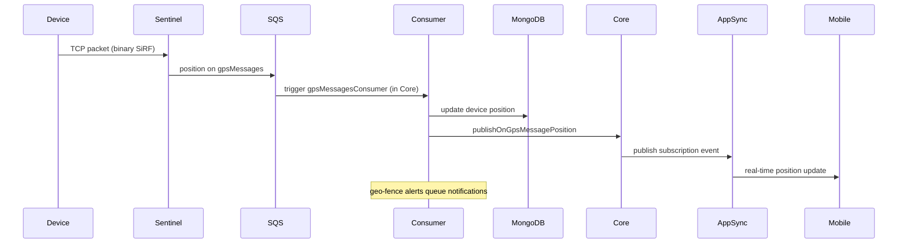
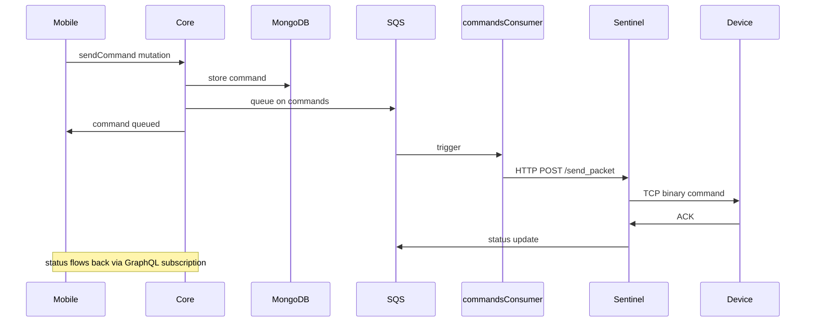
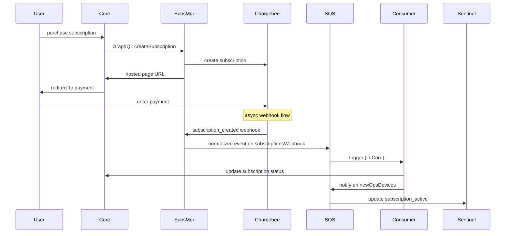
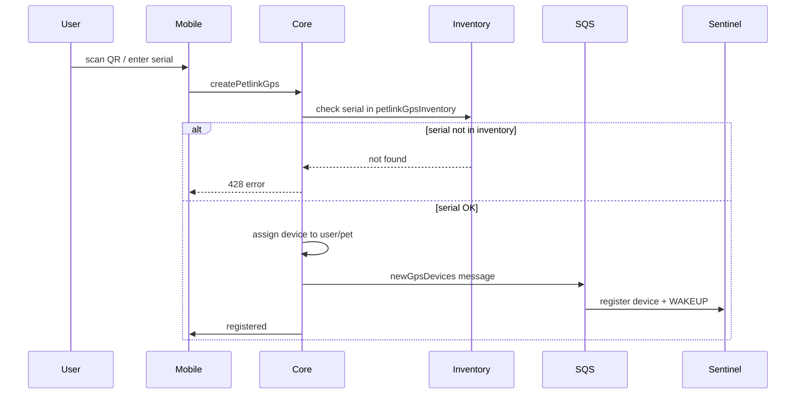
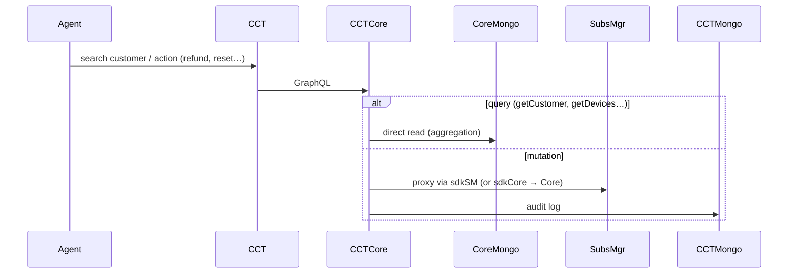

# Data Flows — canonical cross-service views

Stable architectural views of how data moves through the system (not implementation details). For per-domain step-by-step journeys see the other `docs/` files.

## 1. Device → User (Position Updates)

## 2. User → Device (Send Command)

## 3. Subscription Purchase

## 4. Device Registration

## 5. Customer Support (CCT)

## 6. Legacy Data Migration (petlink-data-migration)
`migrationOnDemand` orchestrates per user: check already migrated → read legacy MySQL → insert USER → sync sub-migrations via Lambda Invoke (pets+devices+Sentinel registration, ESA, geofences, subscriptions via Chargebee) → create Cognito account → `migrated=1` in MySQL → enqueue async SQS history migrations (positions, activities, notifications) → welcome posts. Bulk mode: `bulkMigration` enqueues one SQS message per non-migrated user → `bulkMigrationConsumer` invokes the orchestrator. Details: `docs/migration/migration.md`.
